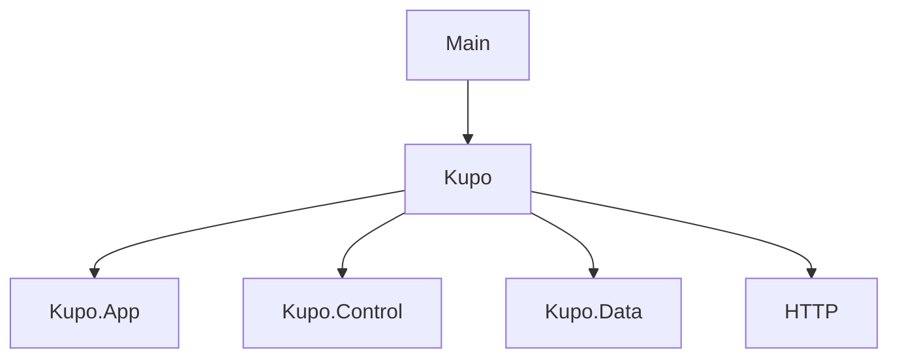
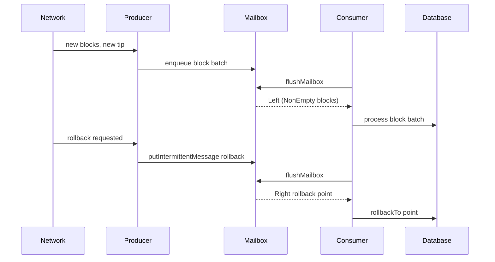
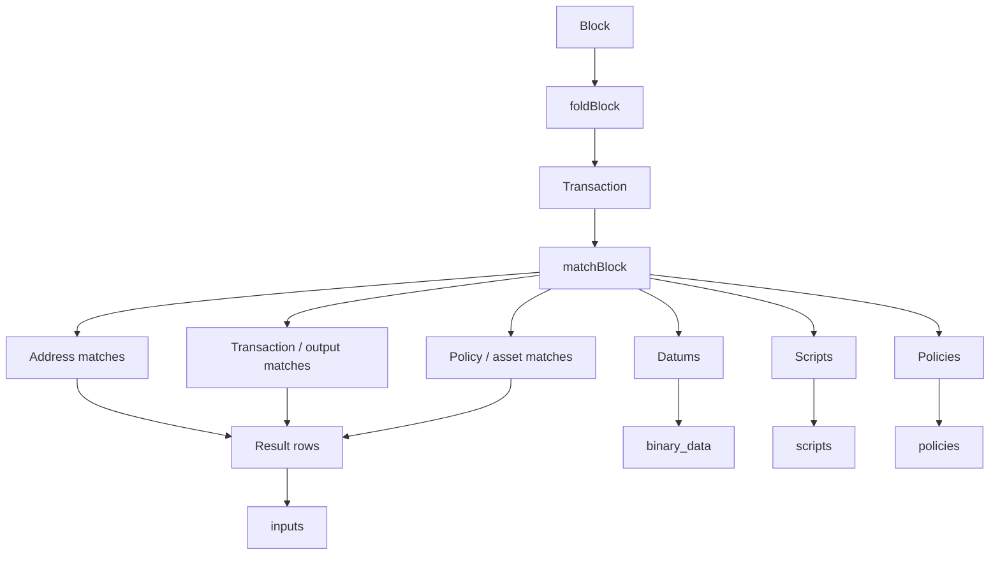
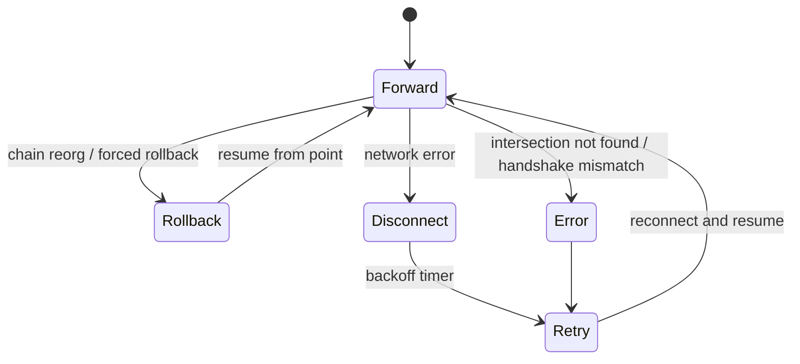

# Design of Haskell source code

## Overall architecture

- a chain producer continuously reads blocks from the Cardano network (via a
  Cardano node, Ogmios, or Hydra), into a mailbox
- a consumer reads blocks from the mailbox, matches transactions against
  configured patterns and persists derived state to database,
- the database holds checkpoints, outputs, datums, scripts, policies, and
  rollback metadata,
- an HTTP server exposes database contents, as well as application state
  (health, metrics, configuration).

```mermaid
flowchart TB

    subgraph Blockchain
      Node([cardano-node])
      Ogmios([Ogmios])
      Hydra([Hydra])
    END

    subgraph Kupo
      Producer[Chain producer]
      Mailbox
      Consumer
      DB[(Database)]
      HTTP[HTTP server]
    END

    subgraph App
      Client(HTTP client)
    END

    Producer --> Blockchain
    Producer --> Mailbox
    Consumer --> Mailbox
    Consumer --> DB
    HTTP --> DB
    Client --> HTTP
END
```

The codebase is organized in layers, with the following major modules:

- `Main`: reads command-line arguments, then applies functions from `Kupo` to
  the resulting environment.
- `Kupo`: reads configuration data, constructs the appropriate data structures
  from `Kupo.App`, starts four threads and connects all the parts: chain
  producer, consumer, HTTP server and gardener (garbage-collector for the
  database).
- `Kupo.App`: most of the application logic: which chainProducer to use,
  callbacks, mailboxes, as well as tracing and exception handling.
- `Kupo.Control`: the monads for concurrency, time, network...
- `Kupo.Data`: the domain data structures
- `Kupo.HTTP`: serves HTTP requests (health, matches, checkpoints...)
- producer: reads the chain and emits blocks/rollback signals,
- consumer: drains the mailbox, matches block contents, and writes to the database,
- gardener: periodically prunes and maintains database health,




## Runtime shell and application lifecycle

The `Kupo` monad wraps a `ReaderT (Env Kupo) IO`, which keeps the following
available to all functions in that monad:

- `configuration` stores the runtime configuration,
- `health` tracks connection status, checkpoints, and node tip progress,
- `crashWith` defines how unexpected exceptions terminate the process.

The lifecycle is orchestrated in `kupoWith`, which does the following:

1. resolves the chain producer configuration,
2. initializes the database pool,
3. resolves or obtains network parameters,
4. starts the producer/consumer/gardener/http server concurrently,
5. installs graceful exception handling and signal-aware shutdown behavior.

This is the fundamental execution model: Kupo is not a single linear process; it is a concurrently running system with independent components communicating through shared state and STM primitives.

## Chain producer abstraction

Kupo supports multiple ways to obtain blocks from the network:

- `CardanoNode`: direct connection to a running Cardano node using the local socket,
- `Ogmios`: connect via Ogmios WebSocket or HTTP adapters,
- `Hydra`: use Hydra-specific chain-sync logic,
- `ReadOnlyReplica`: does not produce blocks; it serves health and query endpoints over a snapshot database only.

The producer abstraction hides the actual transport behind `newProducer`, `withFetchBlockClient`, and `newFetchTipClient`. This keeps the rest of the application largely transport-agnostic.

## Concurrency model and the mailbox

The main performance and correctness mechanism is the `Mailbox` abstraction in `src/Kupo/App/Mailbox.hs`.

This mailbox distinguishes between:

- high-frequency messages: blocks arriving continuously from the chain producer,
- intermittent messages: one-off rollback notifications or transformation events.

The producer pushes block messages into a bounded `TBQueue`, while rollback requests are represented as a `TMVar` so they can preempt the normal data flow.

The logic is:

- if a queue of blocks is pending, it drains the entire batch in one atomic step,
- if no block queue is pending but a rollback message exists, it returns that rollback signal,
- the ordering guarantees that block processing and rollback handling do not interleave unpredictably.




## Consumer and state machine logic

The consumer process is defined in `src/Kupo/App.hs` and is responsible for applying incoming blocks to the database.

This makes the consumer a state machine with two main branches:

- `Left blks`: roll forward by applying the block batch to the database,
- `Right pt`: roll back the database to the specified point.

### Roll forward

The match result is then persisted in the database:

- `insertCheckpoints`: recorded points used for rollback and time queries,
- `insertInputs`: persisted matching outputs (UTxOs),
- `insertPolicies`: policy IDs associated with relevant outputs,
- `markInputs` / `deleteInputs`: maintain spent-input state,
- `insertBinaryData` / `insertScripts`: store datums and scripts for later lookup,
- `notifyTip`: update health and synchronization state.

This is where Kupo turns blockchain data into queryable state relative to user-specified patterns.

### Roll backward

Rollback is handled by the database layer. The consumer executes a rollback to a given point and then updates the health state to reflect the new checkpoint. This is essential when the chain reorgs or when new patterns require reindexing from an earlier point.

## Pattern-based indexing model

The main domain logic is `src/Kupo/Data/Pattern.hs`, which defines the pattern language that Kupo uses to decide which blockchain outputs should be indexed.

Pattern categories include:

- any-address wildcard (`*`, `*/*` style patterns),
- exact address match,
- payment credential and delegation credential matches,
- transaction ID and output reference matches,
- asset and policy ID matches,
- metadata tag matches.

The `matchBlock` function walks through each block and collects:

- produced matches,
- consumed spent inputs,
- scripts and datums referenced by the block,
- policies present in the matched outputs.

This is the central indexing engine. It turns raw blockchain transactions into the queryable data model that the HTTP API serves.

The domain types include output references, address, value, script reference, creation point, spending point, and spending metadata.




## Database model and state ownership

The database layer is split between a generic API and backend-specific implementations (`SQLite` and `PostgreSQL`). The schema is optimized for UTxO-style indexing and includes tables for:

- `inputs`: all relevant outputs, including creation and spent metadata,
- `policies`: outputs by policy ID,
- `checkpoints`: rollback and synchronization points,
- `binary_data`: datums and serialized metadata,
- `scripts`: script bodies,
- `patterns`: currently active patterns.

This design matches the indexing semantics: Kupo is not a full ledger database; it preserves exactly the subset of chain state needed to answer address-, datum-, script-, or policy-based queries.

The database is not just a passive store. It is also part of the state machine:

- checkpoints define where the application is safely synchronized,
- spent-input state indicates whether an output has been observed as consumed,
- patterns are stored and can be updated over time,
- rollback logic reverts state to a previously known good point.

---

## 8. The gardener and maintenance cycle

In addition to the main consumer, Kupo runs a `gardener` process to clean up and optimize the database.

Its responsibilities are:

- prune spent inputs once they are safe to delete,
- prune unreferenced datums and scripts,
- optimize or vacuum the database,
- maintain stable index health without blocking the live chain consumer excessively.

It is an asynchronous maintenance loop rather than a transactional part of block processing. This means the fast path remains optimized for indexing, while cleanup happens opportunistically in the background.

## Chain synchronization and rollback state machine

Kupo's producer logic interacts with the network using the Ouroboros chain-sync protocol. The important high-level behavior is that Kupo is constantly either:

- following the current chain forward,
- waiting on a retry after a disconnect,
- rolling back due to a chain reorganization,
- reconnecting and resuming from a checkpoint.

The implementation uses `withExceptionHandler` to classify exceptions:

- retryable network failures are logged and retried,
- handshake errors are not silently retried; they signal configuration mismatches,
- async exceptions are allowed to escape,
- health status is toggled between `Connected` and `Disconnected` based on network state.

The network protocol is abstracted in `Kupo.Control.MonadOuroboros`, where the client opens a `NodeToClient` connection, negotiates protocol versions, and runs a pipelined chain-sync peer over the socket.



## CardanoNode chain producer

### `Kupo.App.newProducer`

This ternary function is applied to:

- a tracer
- a specific chain producer
- a callback

Most of its behaviour is specific to the concrete chain producer. In the case
where this is the CardanoNode (node-to-client protocol), it produces the
following side-effects in IO:

- creation of an empty TMVar for forcedRollback, also wrapped in a closure
  that would put a (point,handler) tuple into the TMVar.
- the rest of its behaviour is dependent on the specific chain producer, in
  this case, CardanoNode:
  * reading the (Cardano) network configuration
  * creation of a mailbox (`Kupo.Mailbox`)
  * creation of a lambda that would:
    + apply `Kupo.App.ChainSync.Node.mkChainSyncClientPipelined` which produces
      a client;
    + apply `Kupo.Control.MonadOuroboros.withChainSyncServer` to that client
      (and various configuration values), producing a server which uses the
      Cardano client-to-node ChainSync mini-protocol to communicate with the
      Cardano Node whose socket was given to Kupo as a command-line argument.
  * applies the callback to the above forcedRollbackCallback, mailbox and lambda.

This `Kupo.App.newProducer` function is partially applied in `Kupo.kupo`, to
the tracer and chain producer configurations, the resulting unary closure being
passed to `Kupo.kupoWith`, where it is called `withProducer`.

### `Kupo.kupoWith`

This function starts with various initialisations (db pool, exception handling,
...).

To recap (see above), the `withProducer` argument is now a unary closure, made
from partial application of `newProducer`. The only missing argument is the
callback.

`kupoWith` creates this callback as a lambda, and applies `withProducer` to it.

This lambda (`newProducer`'s callback argument) takes three arguments (all
passed to it by `newProducer`:

- the forceRollbackCallback (a closure which writes (point,handler) into a
  TMVar)
- the mailbox to be used to queue blocks that have been received from the
  Cardano Node
- a closure that, when applied, will communicate with the Cardano node.

This lambda starts four threads:

1. The HTTP server
2. The block consumer (which reads blocks from the mailbox and populates the
   database accordingly)
3. The gardener (garbage collector for the database)
4. The block producer.

For this last one (the block producer), the function that executes in the
thread does the following:

- works out where to start syncing from (using the database and/or command-line
  arguments)
- calls The "block producing closure" that was passed by 'newProducer' when it
  called the callback.

Since this "block producing closure" (which is coded in `newProducer`) sets up
the machinery to connect to a Cardano node and perform chain sync, this thread
goes on forever, listening to the Cardano node's socket.

When it receives a new block from the Cardano node (roll forward), it puts it
in the mailbox.

TODO: what happens when it receives rollback from network? What is
forcedRollback (from HTTP?)

## Cardano Node-to-Node

The difference here is that the node-to-node ChainSync mini-protocol produces headers only.

The block producer will therefore need an additional step:

- chain sync will not put blocks directly into the block mailbox used by the
  consumer, but will put headers into a separate header mailbox.
- an additional thread will read headers from the header mailbox, perform block
  fetches, and put the resulting blocks in the block mailbox.

TODO: where do I insert this additional component?

## Health, status, and HTTP-facing model

The health model is kept in a shared `TVar` and updated by:

- the producer when it connects or disconnects,
- the consumer when it processes new checkpoints,
- the HTTP path when reading health and metrics.

Health tracks:

- connection status,
- most recent node tip,
- most recent checkpoint,
- the current clock tick,
- configuration mode (deferred or regular index installation).

The HTTP server (`src/Kupo/App/Http.hs`) exposes a REST surface over:

- `/health` and `/metrics`: health, availability, and Prometheus metrics,
- `/checkpoints`: checkpoint list and ancestor lookup,
- `/matches`: query indexed outputs,
- `/datums`, `/scripts`, `/metadata`: lookup of referenced data,
- `/patterns`: pattern management and dynamic reindexing.

This means that Kupo is both a live blockchain synchronizer and a query server
over the state it derives from the chain.

